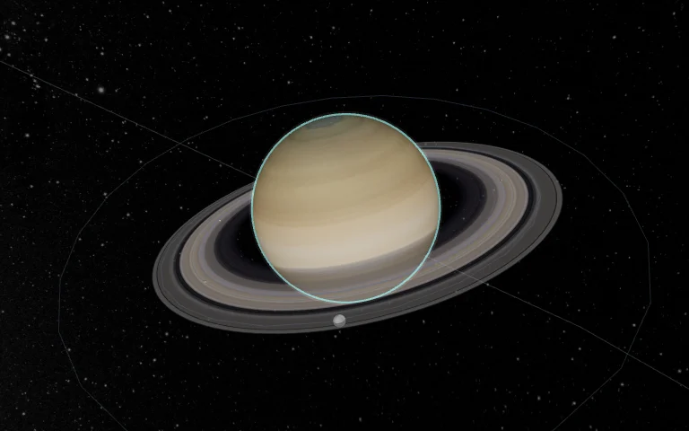
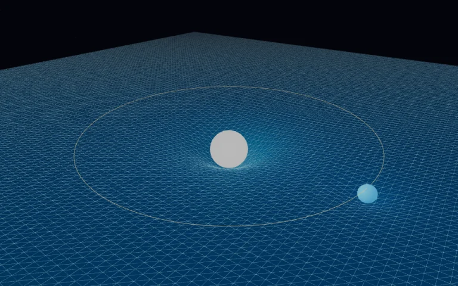
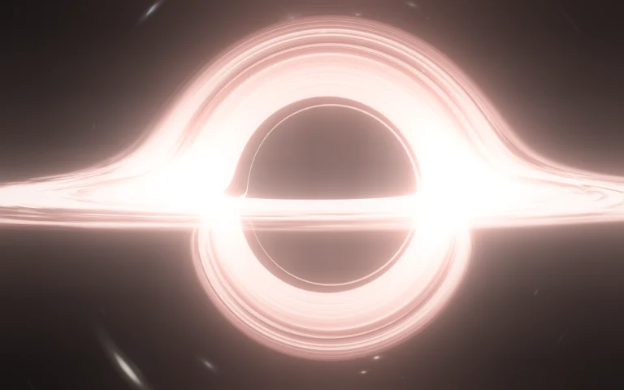

# physics-sims

Three interactive physics and astronomy simulations that run in the browser,
built on [Three.js](https://threejs.org/). There is nothing to install or build:
serve the folder, open the launcher, and pick a scene.

<table>
  <tr>
    <td align="center" width="33%">
      <a href="./Solar-System/"></a>
      <br /><b><a href="./Solar-System/">Solar System</a></b>
      <br /><sub>Planets and major moons where they were, or will be, on any date</sub>
    </td>
    <td align="center" width="33%">
      <a href="./general-relativity/"></a>
      <br /><b><a href="./general-relativity/">Spacetime Curvature</a></b>
      <br /><sub>The rubber-sheet picture of gravity, with masses you adjust live</sub>
    </td>
    <td align="center" width="33%">
      <a href="./gargantua/"></a>
      <br /><b><a href="./gargantua/">Gargantua</a></b>
      <br /><sub>A ray-traced spinning black hole recreating the <i>Interstellar</i> shot</sub>
    </td>
  </tr>
</table>

## Quick start

```bash
git clone https://github.com/Alfredo-Sandoval/physics-sims.git
cd physics-sims
python3 -m http.server 8888
```

Open <http://localhost:8888/> for the launcher. Each scene also has its own URL,
such as <http://localhost:8888/Solar-System/>.

Any static server works. Opening `index.html` straight from disk does not: the
scenes use ES modules, import maps, and `fetch`, which browsers block on
`file://` pages.

## The simulations

### Solar System

The eight planets, their major moons, the asteroid and Kuiper belts, and named
asteroids, placed by date. Fly between bodies, run time forward or backward,
or jump to any date.

**Try this**

- Press <kbd>1</kbd>–<kbd>8</kbd> to fly to a planet, then pick one of its moons
  from the second dropdown.
- Press <kbd>S</kbd> to switch from enhanced sizes to true relative scale and
  see how small the planets really are.
- Use the date picker to jump to a birthday or a launch date and see where
  everything was.
- Press <kbd>?</kbd> for every shortcut, or <kbd>/</kbd> to search for a body.

**How real is it?** Planet positions come from bundled
[JPL Horizons](https://ssd.jpl.nasa.gov/horizons/) samples, with Keplerian
elements outside the sampled window. Planet poles use IAU directions, so the
seasons fall on the right dates, and Earth's Moon matches its real phase to
within a day. Some things are scaled for viewing: bodies are enlarged by
default, orbital spacing is compressed, surface rotation is slowed, and the
fastest moons run on a compressed clock. The
[display policy](./Solar-System/README.md#display-policy) explains each choice.

[Full controls and details →](./Solar-System/README.md)

### Spacetime Curvature

Gravity drawn as a surface that masses sink into: a central mass, a smaller
body orbiting it, and sliders for both.

**Try this**

- Drag **Mass** up to deepen the central well, then raise **Orb** to see the
  orbiting body drag its own dimple around.
- Lower **Fall** so curvature reaches farther, and watch the two wells merge.
- Press <kbd>W</kbd> to hide the grid and leave only the shaded surface.

**How real is it?** This is a teaching visual, not a solution of Einstein's
field equations. The surface height is a softened inverse-power potential, the
orbit is a fixed circle, and the units are arbitrary. It is meant to build
intuition for how mass shapes a gravity well.

[Full controls and details →](./general-relativity/README.md)

### Gargantua

A spinning (Kerr) black hole ray-traced per pixel, opening on the shot from
_Interstellar_. Orbit it, change its spin, and switch between the film's look
and a physically shaded disk.

**Try this**

- Open the gear button for the controls, then push **Spin** toward 0.998 and
  watch the horizon and ISCO readouts shrink.
- Raise **Real** to 1 to add Doppler beaming and gravitational redshift: the
  side of the disk moving toward you turns brighter and bluer.
- Click **Edge** or **Top** to snap the view, <kbd>C</kbd> for the cinema
  letterbox, and <kbd>R</kbd> to return to the film shot.

**How real is it?** Light rays follow exact Schwarzschild null geodesics plus a
frame-dragging term fitted to Kerr photon orbits, which matches the shadow edge
to within about 2% up to spin 0.9. Disk speed, redshift, and the innermost
stable orbit (ISCO) use exact Kerr formulas. The default view reproduces the
film's published geometry (James et al. 2015), which left out Doppler beaming;
**Real** puts it back.

[Full controls and details →](./gargantua/README.md)

## Requirements

- A recent desktop or mobile browser with WebGL 2. The Solar System uses WebGPU
  when the browser supports it and falls back to WebGL otherwise.
- An internet connection. Three.js and anime.js load from the
  [unpkg](https://unpkg.com/) CDN through import maps, and the pages load
  Google Fonts.
- Node.js `^20.19` or `>=22.12`, only for the Gargantua dev server and the
  Node-based checks.

## Troubleshooting

| Symptom | Cause and fix |
| --- | --- |
| Blank page, with module or CORS errors in the console | The page was opened from disk. Serve the folder as in [Quick start](#quick-start). |
| Scene never finishes loading | Three.js could not be fetched from unpkg. Check your connection or any content blocker. |
| Black canvas or a WebGL error | WebGL 2 is unavailable. Turn on hardware acceleration in your browser settings; `chrome://gpu` shows its status in Chrome. |
| `Address already in use` | Port 8888 is taken. Run `python3 -m http.server 8000` and open that port instead. |

## Development

### Gargantua with Vite

Gargantua also runs as a small npm + Vite app, with live reload and a
production build:

```bash
cd gargantua
npm install
npm run dev      # http://localhost:5173/
npm run build    # production bundle in dist/
```

### Tests

There is no top-level `package.json`, so run each `npm` command inside its
project folder.

| Suite | Command | What it checks |
| --- | --- | --- |
| Solar System data | `cd Solar-System && npm test` | Data, assets, module boundaries, and positions against the Horizons samples for all eight planets |
| Solar System in the browser | `uv run --python 3.12 --with playwright tests/run_browser_tests.py` | Boots the app in headless Chromium and checks rendering, labels, navigation, time controls, layout, and cleanup |
| Ephemeris parser | `uv run --python 3.12 --with hypothesis tests/test_ephemeris_properties.py` | Property-based tests of the JavaScript ephemeris parser |
| Gargantua | `cd gargantua && npm ci && npm test` | Smoke checks, then a production build |

The browser suite needs Chromium for Playwright once:
`uv run --python 3.12 --with playwright playwright install chromium`. To watch
it run instead, serve the repo root and open
<http://localhost:8888/tests/index.test.html>.

### Repo layout

```text
physics-sims/
├── index.html              # launcher page
├── launcher.css            # launcher styling
├── previews/               # WebP stills captured from the simulations
├── Solar-System/           # modular Solar System app (static)
├── general-relativity/     # spacetime curvature demo (static)
├── gargantua/              # black hole renderer (static, or npm + Vite)
└── tests/                  # browser and property tests for the Solar System
```

## Credits

- [Three.js](https://threejs.org/) for rendering
- Planet ephemerides from [JPL Horizons](https://ssd.jpl.nasa.gov/horizons/);
  named asteroid orbits from the JPL Small-Body Database
- Moon texture (LRO LROC mosaic) and the Deep Star Maps 2020 sky from
  [NASA's Scientific Visualization Studio](https://svs.gsfc.nasa.gov/) (public
  domain). Titan, Titania, Umbriel, and Triton reuse other moons' maps until
  full-globe textures are added.
- Gargantua's reference geometry from O. James, E. von Tunzelmann, P. Franklin
  & K. S. Thorne, "Gravitational lensing by spinning black holes in
  astrophysics, and in the movie _Interstellar_", _Class. Quantum Grav._ 32,
  065001 (2015)

## License

MIT. See [LICENSE](LICENSE).
